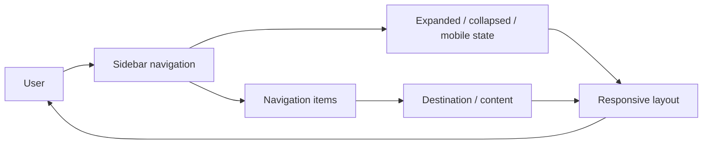
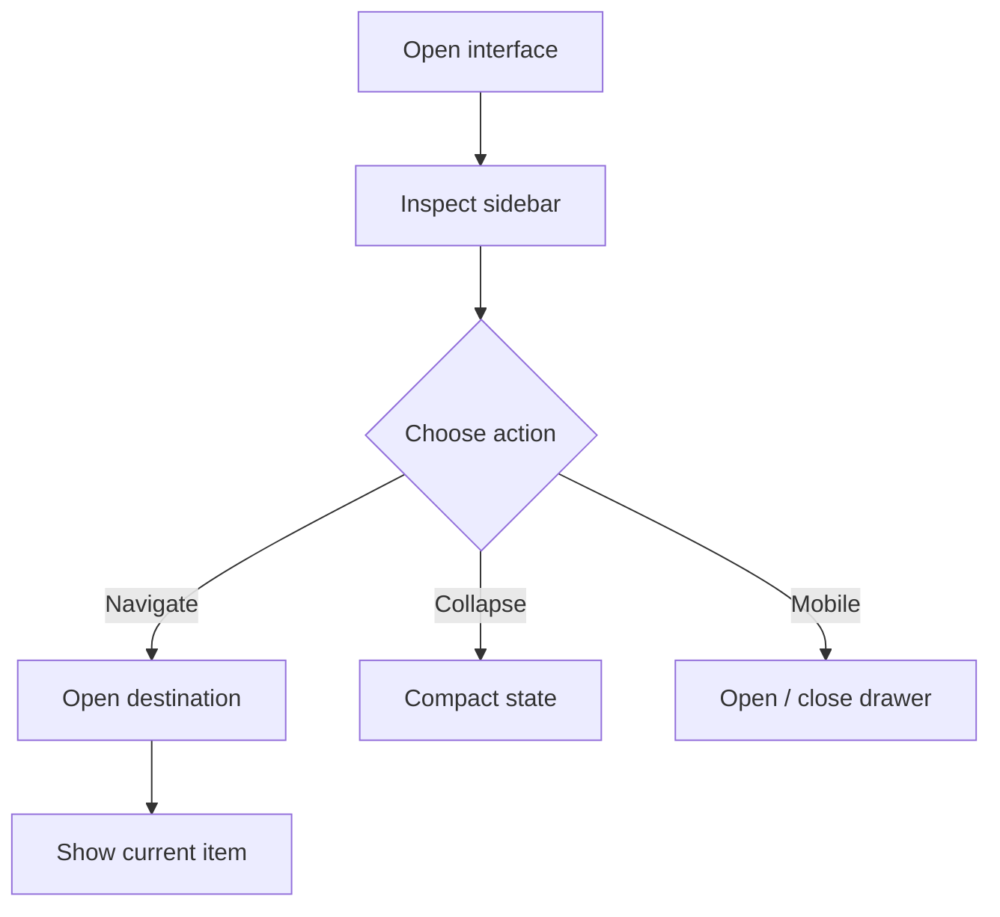
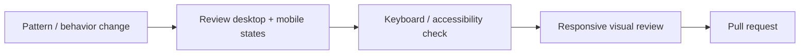

<div align="center">

# Sidebar Showcase

**A UI showcase for exploring sidebar navigation patterns, responsive states, interaction behavior, and reusable layout ideas.**


[Browse source](https://github.com/Nischhalsubba/sidebar-showcase/tree/main) · [Issues](https://github.com/Nischhalsubba/sidebar-showcase/issues)

</div>

## Overview

**Sidebar Showcase** is a focused interface repository for studying navigation rather than pretending a sidebar is just a rectangle attached to the left edge of existence. The useful questions are hierarchy, responsive behavior, current-state feedback, keyboard access, and how content reacts when navigation expands or collapses.

<details open>
<summary><strong>🏗️ Interactive UI architecture</strong></summary>



</details>

## Interaction flow



## Audience guide

| Audience | Focus |
|---|---|
| Developers | Component structure, state and responsive logic |
| Designers | Navigation hierarchy, density, motion and selected states |
| Accessibility reviewers | Keyboard order, focus, labels and mobile drawer behavior |
| Product teams | Whether navigation matches real information architecture |

## Getting started

```bash
git clone https://github.com/Nischhalsubba/sidebar-showcase.git
cd sidebar-showcase
```

Use the repository manifests/lockfiles to determine current development commands.

## Design & accessibility

Use real buttons for toggles, communicate expanded state, trap/focus mobile overlays appropriately, support Escape when relevant, keep active navigation distinguishable without color alone, and ensure collapsed icon-only controls retain accessible names.

## SEO & discoverability

Use accurate terms such as **sidebar UI, sidebar navigation, responsive sidebar, dashboard navigation, navigation component, and sidebar design patterns** in repository documentation. Demo pages should still use useful titles, descriptions and semantic headings.

## Contribution flow


